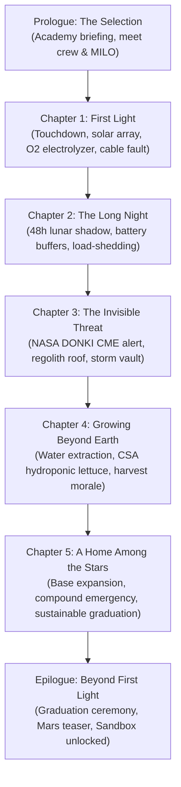

# 📖 Beyond Earth: First Light — Complete Story Bible & Narrative Specification

> **Document Status:** Single Source of Truth for all Narrative, Dialogue, Characters & Story Systems  
> **Project:** Beyond Earth: First Light (NASA Space Apps Challenge 2026)  
> **Target Audience:** Students & Children (Ages 7–12)  

---

## Table of Contents
1. [Story Premise & Setting](#1-story-premise--setting)
2. [Character Bibles](#2-character-bibles)
3. [Campaign Structure & Arc](#3-campaign-structure--arc)
4. [Complete Narrative Script (All Chapters)](#4-complete-narrative-script)
   - [Prologue: The Selection](#prologue--the-selection)
   - [Chapter 1: First Light](#chapter-1--first-light)
   - [Chapter 2: The Long Night](#chapter-2--the-long-night)
   - [Chapter 3: The Invisible Threat](#chapter-3--the-invisible-threat)
   - [Chapter 4: Growing Beyond Earth](#chapter-4--growing-beyond-earth)
   - [Chapter 5: A Home Among the Stars](#chapter-5--a-home-among-the-stars)
   - [Epilogue: Beyond First Light & Mars Tease](#epilogue--beyond-first-light)
5. [Ambient In-Game Dialogue & Crew Banter](#5-ambient-in-game-dialogue--crew-banter)
6. [Dialogue Presentation & UI System](#6-dialogue-presentation--ui-system)
7. [Narrative Event System & Triggers](#7-narrative-event-system--triggers)
8. [Externalized Narrative Data Format (JSON)](#8-externalized-narrative-data-format-json)

---

# 1. Story Premise & Setting

### 1.1 Premise
* **Title:** Beyond Earth: First Light
* **Fictional Year:** 2042
* **Program:** Project First Light (Lunar Operations Academy)

Humanity is preparing to establish a permanent lunar research outpost. Before a real settlement can operate independently, astronaut teams must prove that they can manage the immense engineering, physiological, and environmental challenges of living beyond Earth.

The player is selected for an advanced astronaut training program and appointed **Junior Mission Commander** of a simulated four-person expedition at the **Lunar South Pole (Shackleton Crater Rim)**.

### 1.2 The Simulation Framing
The entire campaign takes place within an advanced NASA astronaut training simulation. The player operates from a mission-control terminal while the four astronaut characters operate inside the lunar environment.

**Why this framing matters for children:**
* It eliminates violent failure: there are **no character deaths**, no suffocation animations, and no traumatic "Game Over" screens.
* Failures are reframed as **instructive diagnostic events**: when power drains or oxygen drops, the simulation pauses, diagnoses the physical root cause, explains the relevant NASA science, and empowers the child to adjust their strategy and recover.
* It instills a growth mindset: space exploration is not about being superhuman, but about systems thinking, calm diagnostics, and teamwork.

### 1.3 Central Theme
> *"Humanity doesn't conquer space by being stronger than its environment, but by understanding it and learning to work with it."*

---

# 2. Character Bibles

The story centers on the collaborative relationship among four human astronauts and their hyper-competent AI flight assistant.

### 2.1 Captain Elena Ruiz (38, Spanish) — Mission Commander
* **Role:** Expedition Commander & Flight Supervisor.
* **Specialty:** Mission operations, risk assessment, and astronaut safety.
* **Personality:** Calm, disciplined, thoughtful, protective.
* **Strength:** Emergency leadership, keeping the crew focused during compound crises.
* **Weakness:** Occasionally overly cautious, reluctant to deviate from standard checklists.
* **Character Arc:** Learns that leadership means trusting the individual strengths of her crew and adapting when initial procedures fail.
* **Signature Line:** *"A good mission isn't about avoiding every problem. It's about knowing how to solve them."*

### 2.2 Amir Haddad (29, Algerian) — Systems Engineer
* **Role:** Lead Habitat Engineer.
* **Specialty:** Electrical networks, rover mechanics, machinery, and cable routing.
* **Personality:** Energetic, inventive, humorous, hands-on tinkerer.
* **Strength:** Rapid technical improvisation and practical spatial problem-solving.
* **Weakness:** Sometimes favors quick, scrappy fixes over long-term structural reliability.
* **Character Arc:** Learns that a functioning machine is only worthwhile if it is sustainable and safe over time.
* **Signature Line:** *"Before we build something bigger, let's make sure what we already have actually works!"*

### 2.3 Dr. Nia Okafor (32, Nigerian) — Science Officer
* **Role:** Lead Scientist & Botanist.
* **Specialty:** Planetary geology, lunar ice volatiles, space biology, and closed-loop ECLSS.
* **Personality:** Patient, analytical, optimistic, endlessly curious.
* **Strength:** Systems-level scientific synthesis and identifying resource opportunities (water ice, regolith mass).
* **Weakness:** Can get absorbed in scientific observations when urgent operational action is needed.
* **Character Arc:** Learns to balance pure scientific discovery with operational survival priorities.
* **Signature Line:** *"Sometimes the smallest discovery can solve the biggest problem."*

### 2.4 Dr. Daniel Park (34, South Korean) — Medical Officer
* **Role:** Crew Physician & Life Support Monitor.
* **Specialty:** Human physiology, radiation dosimetry, cabin atmosphere quality, and mental wellbeing.
* **Personality:** Gentle, observant, empathetic, reassuring, with dry wit.
* **Strength:** Attuned to crew fatigue, CO₂ toxicity signs, and radiation exposure thresholds.
* **Weakness:** Can be overly anxious about worst-case medical scenarios.
* **Character Arc:** Learns that thorough preparation transforms anxiety into confidence.
* **Signature Line:** *"Let's make sure the crew is safe before we worry about anything else."*

### 2.5 M.I.L.O. — Mission Intelligence & Logistics Operator
* **Role:** AI Flight Companion & Junior Commander's Co-Pilot.
* **Personality:** Upbeat, helpful, proud of its rapid calculation capacity, with gentle, deadpan humor.
* **Function:** Monitors life support telemetry, flags anomalies, answers questions in plain kid-friendly language, and offers strategic hints.
* **Character Arc:** Begins believing mathematical optimality is all that matters; gradually learns that human teamwork, psychological morale, and adaptability are equally critical.

```
Example Dynamic:
Amir:   "MILO, can you calculate the most efficient arrangement for our new solar panels?"
MILO:   "Certainly. I have calculated 2,381 possible arrangements."
Amir:   "And the best one?"
MILO:   "The one that doesn't involve you standing on the cables."
Elena:  "I think we'll manage without that arrangement."
MILO:   "Excellent. My recommendation has been accepted."
```

---

# 3. Campaign Structure & Arc

The campaign is a **linear 5-chapter story** bracketed by an interactive Prologue and an inspirational Epilogue. After completing the campaign, **Creative Sandbox Mode** is unlocked.



---

# 4. Complete Narrative Script

*(All spoken dialogue is externalized and pauses simulation time during key cutscenes).*

---

## PROLOGUE — THE SELECTION

**Narrative Purpose:** Introduce the training academy, player identity, crew characters, and M.I.L.O.

### Scene 1: The Academy
*(Black screen. Gentle ambient electronic tones. Distant stars fade in as the camera moves toward a high-tech training facility).*

**Narrator:**  
"For generations, humanity looked toward the stars and wondered what existed beyond our home."  
"Now, a new chapter of exploration is beginning."

**MILO:** "Good morning, Commander! Welcome to the Lunar Operations Academy."  
**MILO:** "I am M.I.L.O., your personal Mission Intelligence and Logistics Operator. You can call me MILO."  
**Player:** "And what exactly do you do?"  
**MILO:** "I monitor telemetry, analyze resource flows, provide recommendations, and occasionally remind engineers to stop touching things they don't understand."  
**MILO:** "That last function was added specifically for Engineer Haddad."  
**Amir:** "I heard that!"  
**MILO:** "Excellent. My audio output is fully calibrated."

*(Elena enters the briefing room).*

**Elena:** "Welcome, Commander. I'm Captain Elena Ruiz. I'll be supervising your expedition."  
**Elena:** "You've been selected to lead a simulated lunar research settlement. You'll be responsible for the spatial planning and resource trade-offs that keep our crew safe."  
**Player:** "A whole settlement? On my first mission?"  
**Elena:** "Don't worry. You have an experienced crew beside you."

*(Nia and Daniel enter).*

**Nia:** "I'm Dr. Nia Okafor. I oversee planetary science, regolith composition, and environmental life-support research."  
**Daniel:** "And I'm Dr. Daniel Park. I monitor human physiology, cabin air quality, and the crew's wellbeing."  
**Amir:** "And I'm Amir. If something has wires, high-voltage electricity, or moving joints, it's my department."  
**MILO:** "And if something goes wrong, it will rapidly become everyone's department."  
**Amir:** "You're supposed to be encouraging!"  
**MILO:** "I am. Statistically, our probability of success is exceptionally high."

### Scene 2: The Mission Briefing
*(Elena activates a 3D holographic projection of the Moon, zooming into the South Pole).*

**Elena:** "Our mission is Project First Light. We will touch down on the rim of Shackleton Crater."  
**Nia:** "The Lunar South Pole is unique. The crater rims receive near-permanent sunlight on elevated peaks, while deep crater floors lie in perpetual shadow, trapping billions of tons of water ice."  
**Daniel:** "But there is zero breathable atmosphere, vacuum pressure, extreme radiation, and temperatures swing from $+120^\circ\text{C}$ in sunlight to $-180^\circ\text{C}$ in shadow."  
**Amir:** "Which means solar arrays, battery banks, power cables, and plenty of heavy construction."  
**MILO:** "I have pre-computed 4,782 possible settlement layouts."  
**Player:** "Which one should we use?"  
**MILO:** "That depends on your spatial logic, Commander. Every decision has an immediate cost and a delayed consequence."  
**Elena:** "That's why you're in command. There isn't always one easy answer. Prepare for touchdown."  
**MILO:** "Simulation initialized. Descent sequence active in 3... 2... 1..."

---

## CHAPTER 1 — FIRST LIGHT: BASE SYSTEMS TOUR & DUAL PLAY MODES

**Theme:** Base systems understanding and choice of play mode.  
**Gameplay Modes:**
1. **"Start building my own base"**: The player starts from scratch on raw lunar regolith with a budget of 1400 Materials (Equipment Specification §11.1), designing and powering their outpost without guidance restrictions.
2. **"Start by pre-built base"**: The game initializes with a complete reference outpost (8 Solar Panels, 8 Battery Banks, 2 CO₂ Scrubbers, Oxygen Electrolyzer, Water Recycler, Heating System, Growth Farm, Regolith Shield, Storm Vault, Earth Channel, and Habitat linked by cables). An interactive dialogue tour (`S-BASE-TOUR`) guides the player through each machine's survival role.

### Scene 1: Outpost Systems Tour (`S-BASE-TOUR`)
*(Holographic telemetry highlights the glowing First Light Outpost complex).*

**MILO:** "Welcome to First Light Outpost, Commander! You are looking at a complete, self-sustaining lunar survival base on Shackleton Crater Rim."  
**Leo:** "Our lives depend on every machine here working together in balance. Let's inspect each sector so you understand how they keep us alive."  
**Amir:** "First up: ENERGY! Our 8 Solar Panels harvest 160 kW from the polar sun. Beside them are 8 Battery Banks storing 800 kWh for the 12-hour lunar night. And our Power Cables link every machine into a unified grid."  
**Daniel:** "Next: ATMOSPHERE! The four of us exhale CO₂ with every breath. Two CO₂ Scrubbers filter out 4 kg of toxic gas every hour. Without them, carbon dioxide poisons our blood within hours."  
**Nia:** "For fresh air, our Oxygen Electrolyzer splits water into hydrogen and breathable oxygen (+2.5 kg/h). And our Water Recycling System purifies wastewater and humidity (+3 L/h)!"  
**Daniel:** "If our primary loop drops, the Emergency Oxygen Generator serves as our backup lifeline."  
**Amir:** "Outside in shadow it drops to -180°C. Our automated Heating System maintains cabin temperature safely at 21°C."  
**Nia:** "Our Growth Farm recycles CO₂, yields supplemental oxygen, and grows fresh crops for crew morale."  
**Leo:** "Our Lunar Soil Radiation Shield blocks cosmic rays, and our Subterranean Storm Vault protects us during solar flares. Our Earth Channel provides vital logistics communications with Houston."  
**MILO:** "Systems briefing complete. The outpost is yours to command! You can continue managing this pre-built base, or select 'Start building my own base' to design your own from scratch."

### Objective 3: Establish Oxygen Production & Scrubbing
**Nia:** "Now for breathable air. The crew needs a steady oxygen supply and carbon dioxide removal."  
**MILO:** "The Oxygen Electrolyzer splits stored water into breathable oxygen and hydrogen."  
**Daniel:** "And the CDRA Scrubber absorbs toxic CO₂ exhaled by the astronauts."  
*(Player places Electrolyzer and Scrubber).*  
**MILO:** "ECLSS modules operational. Atmospheric pressure rising to $101.3\text{ kPa}$."

### Objective 4: Connect the Power Grid
**MILO:** "Commander, electrical current cannot leap across empty space. We need cables."  
**Amir:** "Think of cables like highways. Electricity needs a connected path to flow."  
*(Player lays Power Cables connecting Solar Array to Habitat and Electrolyzer).*  
**MILO:** "All circuits closed. Full power distribution confirmed."

### Scripted Anomaly: The First Malfunction
*(Warning klaxon sounds. Oxygen meter turns yellow and begins decreasing).*

**MILO:** "Warning! Oxygen production has abruptly halted."  
**Daniel:** "Cabin oxygen partial pressure is dropping: $19\text{ kPa}... 18\text{ kPa}$."  
**Amir:** "Wait, the electrolyzer didn't burn out. The power indicator is dead. A connection broke!"  
**Elena:** "Commander, trace the cable network. Locate the break and reconnect it."  
*(Player inspects the grid, finds the disconnected cable node, and clicks to repair).*  
**MILO:** "Circuit re-established! Power restored. Oxygen levels recovering."  
**Daniel:** "Cabin oxygen stabilized at $21\text{ kPa}$. Good catch, Commander."  
**Amir:** "And that is why Rule Number One of space engineering is: check your connections!"

### Chapter Completion
*(Habitat interior windows glow warm yellow against the dark lunar sky).*

**Nia:** "It's strange. Seeing those habitat lights glowing in the vacuum makes this desolate crater feel... welcoming."  
**Daniel:** "A tiny outpost of Earth, 384,000 kilometers from home."  
**Elena:** "First Light Outpost is officially operational. Outstanding command work."  
**MILO:** "Chapter 1 completed. New technology unlocked: Battery Banks and Power Priorities."

---

## CHAPTER 2 — THE LONG NIGHT

**Theme:** Energy independence and night survival.  
**Gameplay Focus:** Lunar orbital illumination, battery storage, and manual load-shedding.

### Scene 1: The Creeping Shadow
*(The grazing solar angle drops. Mountain shadows lengthen across the outpost).*

**MILO:** "Good morning, Commander. Outpost telemetry is stable, but orbital calculations indicate an impending issue."  
**Amir:** "I've been crunching the numbers with MILO. We're about to run into a giant problem."  
**Elena:** "Explain, Amir."  
**Amir:** "Our solar arrays generate great power right now, but a 48-hour lunar shadow is sweeping over Shackleton Ridge."  
**Player:** "Can't we just point the solar panels higher?"  
**Amir:** "Not when a mountain ridge blocks 100% of the sunlight."  
**Nia:** "The Moon rotates slowly. While parts of the rim get extended sun, shadows here can last days."  
**MILO:** "Current battery reserves: 0 kWh. When the sun dips, power drops to zero in 14 minutes."  
**Elena:** "Then we construct battery storage before that shadow arrives."

### Objective 1: Build Battery Banks
**Amir:** "We need high-capacity Battery Banks connected directly to the primary grid."  
*(Player constructs Battery Bank).*  
**MILO:** "Battery Bank online. Surplus solar energy is charging the storage cells."  
**Amir:** "Remember: batteries store surplus power; they don't generate new power. Don't waste a single watt!"

### Objective 2: Configure Power Load-Shedding
**MILO:** "Simulated nightfall begins in 60 seconds. Demand currently exceeds storage capacity."  
**Elena:** "Commander, open the Power Priority panel. Decide what stays on and what gets turned off."  
**Daniel:** "Habitat heating and oxygen scrubbers cannot be compromised."  
**Amir:** "We can switch off the research antennas and external floodlights."  
*(Player toggles non-essential systems off).*  
**MILO:** "Load-shedding active. Base consumption reduced by $40\%$."

### Objective 3: Survive the Darkness
*(Sunlight completely disappears. The outpost is plunged into pitch darkness; buildings switch to battery indicators).*

**MILO:** "Solar generation: $0.0\text{ kW}$. Outpost running entirely on battery reserves."  
**Amir:** "The batteries are holding... discharge rate is steady."  
**Nia:** "Look outside. Without the Sun, the stars here are brighter than anything on Earth."

### Scripted Anomaly: Battery Thermal Drop
**MILO:** "Caution! Battery Bank 2 internal temperature dropping. Discharge efficiency degraded by $30\%$."  
**Amir:** "The extreme cold is chilling the cells! We need to isolate Bank 2 and reroute through Bank 1."  
*(Player redirects the circuit via the Power Panel).*  
**Amir:** "Circuit rerouted! Battery temperature stabilized."  
**MILO:** "Discharge rate back to safe limits. Battery reserves will endure until sunrise."

### Chapter Completion
*(Sunlight crests over the ridge, striking the solar panels. Electric current pulses blue on cables).*

**MILO:** "Sunlight detected! Solar arrays generating $+20\text{ kW}$. Batteries beginning recharge cycle."  
**Amir:** "We made it! Two whole days in freezing dark, and the lights never went out."  
**Elena:** "Disciplined planning turns emergencies into routine procedures."  
**MILO:** "Chapter 2 completed. Technology unlocked: Kilopower Fission Reactor."

---

## CHAPTER 3 — THE INVISIBLE THREAT

**Theme:** Space weather and radiation protection.  
**Gameplay Focus:** NASA DONKI integration, regolith shielding, and storm shelter procedures.

### Scene 1: The Solar Alert
*(Inside the habitat, Nia's research terminal begins beeping rhythmically).*

**Nia:** "Commander, look at the solar telemetry feed from NASA DONKI."  
**MILO:** "Space Weather Alert: Coronal Mass Ejection detected from Active Sunspot 3842."  
**Elena:** "What's the trajectory, MILO?"  
**MILO:** "Direct Earth-Moon trajectory. High-energy solar protons will impact our position in under two hours."  
**Player:** "Can our habitat walls block it?"  
**Nia:** "Standard habitat aluminum only stops micrometeoroids. High-energy protons pass right through thin walls, damaging DNA and crew cells."  
**Daniel:** "We need heavy mass shielding, and we need a storm bunker right now."

### Objective 1: Monitor Space Weather Radar
**MILO:** "Opening Space Weather Radar. The NASA DONKI feed monitors real-time solar activity."  
*(Player reviews radar: Risk Level HIGH, proton flux climbing).*  
**Nia:** "A solar flare is light that arrives in 8 minutes. But a Coronal Mass Ejection is a cloud of billions of tons of magnetized plasma traveling millions of kilometers an hour."

### Objective 2: Build Regolith Roof Shielding
**Nia:** "We have the best radiation armor in the solar system right under our boots: lunar regolith."  
**Amir:** "We can use the automated rover to pile 50 cm of regolith over our habitat roofs."  
*(Player builds Regolith Shielding module).*  
**MILO:** "Regolith shielding installed. Cosmic ray exposure reduced by $80\%$."

### Objective 3: Construct the Subterranean Vault
**Daniel:** "For the main CME shockwave, we need a subterranean storm shelter."  
*(Player places Subterranean Vault and connects power).*  
**Daniel:** "The bunker is ready: lead-lined water walls and emergency oxygen."

### Scripted Anomaly: The CME Impact
*(Red emergency sirens flash. Inbound particle shockwave indicator hits zero).*

**MILO:** "EMERGENCY: Coronal Mass Ejection shock front has arrived! Radiation exterior: $120\text{ mSv/h}$!"  
**Elena:** "All crew members: evacuate to the storm shelter immediately!"  
*(Player selects crew and clicks 'Enter Vault').*  
**MILO:** "All 4 astronauts verified inside the Vault. Door sealed."  
*(Exterior camera shows faint static interference on monitors as solar particles bombard the base).*  
**Nia:** "Dosimeter inside the vault reads zero. The regolith and water barriers are absorbing the protons."  
*(Time passes; the storm front passes).*  
**MILO:** "Solar particle flux returning to baseline. Safe to exit shelter."

### Chapter Completion
*(Crew exits vault; Elena inspects the base).*

**Daniel:** "Crew medical check complete. Zero radiation sickness symptoms."  
**Amir:** "The base took a beating from electrostatic dust, but our systems held."  
**Elena:** "Space weather cannot be prevented, Commander. But with proper shielding, it can be survived."  
**MILO:** "Chapter 3 completed. Technology unlocked: Advanced RadLab Dosimeters."

---

## CHAPTER 4 — GROWING BEYOND EARTH

**Theme:** Closed-loop life support and space agriculture.  
**Gameplay Focus:** Water extraction, CSA hydroponics, crop growth cycles, and crew morale.

### Scene 1: Supply Depletion
*(Crew is sitting at the galley table opening packaged foil ration pouches).*

**Daniel:** "The crew is healthy, but our packaged food supply is down to its final two weeks."  
**Amir:** "If I have to eat another freeze-dried beef pouch, I might volunteer for an EVA with no helmet."  
**Nia:** "I have a better solution. The Canadian Space Agency food production research showed we can grow fresh crops in controlled hydroponics."  
**Player:** "Can plants grow on the Moon without soil?"  
**Nia:** "Yes! Hydroponics uses nutrient-infused water delivered directly to plant roots under tuned LED grow lights."  
**MILO:** "Required inputs: water, electricity, carbon dioxide, and thermal regulation."  
**Amir:** "So we need water first."

### Objective 1: Build Water Extractor in Crater Shadow
**Nia:** "Water ice is trapped in the permanently shadowed crater floor. We need an automated extractor."  
*(Player places Water Extractor in shadow zone and runs a power cable to it).*  
**MILO:** "Water Extractor online. Pumping $+10\text{ L/h}$ of purified lunar ice water."

### Objective 2: Deploy CSA Hydroponics Greenhouse
**Nia:** "Now for the greenhouse. We will plant Outredgeous Red Romaine Lettuce and radishes."  
*(Player constructs Hydroponics Tray).*  
**MILO:** "Hydroponic system online. LED grow lights active. Plants absorbing crew CO₂ and emitting fresh O₂."

### Scripted Anomaly: The Water Recycler Clog
**MILO:** "Alert: Hydroponic water pressure dropping. Root zone moisture critical."  
**Nia:** "The irrigation line is clogged! If the roots dry out, the entire crop will wither in two hours."  
**Amir:** "I can clear the valve, but we need to divert water from our reserves while I disassemble it."  
*(Player manages water valves and assists Amir).*  
**Amir:** "Valve cleared and filter replaced! Water pressure restored."  
**MILO:** "Crop hydration normalized."

### Chapter Completion: The First Harvest
*(Greenhouse trays are filled with vibrant red and green lettuce leaves).*

**Nia:** "Commander, come look! Our first harvest is ready."  
**Daniel:** "Fresh greens provide vitamin C and potassium that packaged foods lose over time."  
**Amir:** "An actual fresh salad! On the Moon!"  
**Elena:** "Every gram of food grown here is a gram we don't have to launch from Earth."  
**MILO:** "Crew morale increased by $+25\%$. Nutritional sustainability verified."  
**MILO:** "Chapter 4 completed. Technology unlocked: Advanced Closed-Loop Recycling."

---

## CHAPTER 5 — A HOME AMONG THE STARS

**Theme:** Base integration, compound emergencies, and graduation.  
**Gameplay Focus:** Expanding colony, supporting 8 astronauts, compound dust/shadow disaster, and final debrief.

### Scene 1: The Final Challenge
*(Camera pans across the thriving base: greenhouse, solar arrays, battery banks, regolith shelters).*

**MILO:** "Commander, Earth Mission Control has reviewed our outpost telemetry."  
**Elena:** "They are thoroughly impressed. Now comes the final evaluation of Project First Light."  
**Elena:** "We have been ordered to demonstrate that our outpost can scale to support an expanded expedition of 8 astronauts."  
**Amir:** "Eight people means doubling our power, doubling oxygen, and doubling water recycling."  
**Daniel:** "And maintaining crew health under peak stress."

### Objective 1: Expand Life Support & Habitat Modules
*(Player builds additional Habitat Modules and expands the Oxygen Electrolyzer capacity).*  
**MILO:** "Habitat volume expanded. Life support capacity certified for 8 crew."

### Objective 2: Deploy Continuous Surface Power
**Amir:** "Solar arrays are great, but for a permanent base, we need steady baseload power."  
*(Player deploys the Kilopower Fission Reactor).*  
**MILO:** "Kilopower online. Continuous $+30\text{ kW}$ day and night."

### The Climax: Compound Emergency
*(A sudden tremor shakes the ground; alarms sound across multiple panels).*

**MILO:** "CRITICAL ALERT: Compound anomaly detected!"  
**MILO:** "1. Electrostatic dust storm reducing solar output by $60\%$."  
**MILO:** "2. Cable rupture between Sector A and the primary Habitat."  
**MILO:** "3. Water consumption spiking due to expanded crew demand."  
**Daniel:** "Cabin oxygen is dropping! We have 90 seconds before life support fails."  
**Amir:** "The Kilopower reactor is isolated because of the severed cable!"  
**Elena:** "Commander, stay calm. Prioritize: isolate non-essentials, reroute power, and reconnect the reactor."  
*(Player executes multi-step recovery):*
1. Toggles emergency load-shedding on non-essentials.
2. Reroutes battery reserves to life support.
3. Reroutes cable connection from Kilopower directly to the Habitat.
4. Stabilizes water recycler.  
**MILO:** "Cable reconnected! Kilopower flowing into Habitat life support. Oxygen restored. Dust storm clearing."  
**Amir:** "We did it! Everything held together!"  
**Daniel:** "Vitals are completely stable."  
**Elena:** "Outstanding crisis management, Commander. You handled that like a veteran flight director."

---

## EPILOGUE — BEYOND FIRST LIGHT

### Scene 1: The Graduation Ceremony
*(Camera returns to Mission Control at the Academy. Elena, Amir, Nia, Daniel, and M.I.L.O. stand before a giant screen displaying the thriving lunar base).*

**MILO:** "Final simulation analysis complete."  
**MILO:** "Survivability Score: $96/100$. Energy Efficiency: $94\%$. Radiation Mitigation: $92\%$."  
**Elena:** "Commander, when you started, Shackleton Rim was empty grey dust."  
**Amir:** "Now it's a functioning, self-sufficient lunar research station."  
**Nia:** "You proved that humans can grow food, harvest water, and survive the harshest environment in the solar system."  
**Daniel:** "And most importantly: your crew made it through healthy, safe, and united."  
**MILO:** "Statistical conclusion: Teamwork and scientific preparation are the true drivers of exploration."  
**Elena:** "Congratulations, Commander. You have officially graduated from Project First Light."

*(A golden NASA achievement certificate appears on screen):*
```
┌────────────────────────────────────────────────────────────────────────┐
│                   NATIONAL AERONAUTICS & SPACE ADMINISTRATION           │
│                       PROJECT FIRST LIGHT DIPLOMA                       │
│                                                                        │
│               This certifies that the Junior Mission Commander         │
│          has demonstrated mastery in Lunar Outpost Engineering,        │
│             Closed-Loop Life Support, and Planetary Survival           │
│                                                                        │
│         [ Elena Ruiz ]   [ Amir Haddad ]   [ Nia Okafor ]   [ Daniel Park ] │
│                             [ M.I.L.O. ]                               │
└────────────────────────────────────────────────────────────────────────┘
```

### Scene 2: The Post-Credits Mars Tease
*(The crew is chatting happily when M.I.L.O.'s screen flashes red).*

**MILO:** "Commander, I have just intercepted a high-priority transmission from NASA Deep Space Logistics."  
**Elena:** "Another mission already?"  
**MILO:** "Yes. It concerns a certain rust-colored planet approximately 225 million kilometers from here."  
*(The main holographic display shifts from the silver Moon to a rotating red sphere: MARS).*  
**Amir:** "Mars? Now that is going to take a lot of cables."  
**Nia:** "Ancient river valleys, extinct volcanoes, and permafrost ice... think of the discoveries!"  
**Daniel:** "A nine-month cruise in deep space. We're going to need serious radiation shielding."  
**Elena:** "Enjoy your graduation, Commander. You earned it. But keep your flight suit handy."  
**MILO:** "I have already begun computing possible Martian settlement layouts."  
**Amir:** "Please don't tell me there are thousands again."  
**MILO:** "There are 18,492."  
*(The crew laughs as screen fades to black).*

**Closing Title Card:**  
*"Humanity's journey beyond Earth has only just begun."*

**Unlocked:**
* **Creative Sandbox Mode** (Unlimited materials, freeform lunar building).
* Full NASA/CSA Science Encyclopedia.

---

# 5. Ambient In-Game Dialogue & Crew Banter

These short, charming radio dialogues trigger dynamically during gameplay to make the base feel alive:

| Event Trigger | Character | Ambient Dialogue |
| :--- | :--- | :--- |
| **First Sunrise** | Nia | *"Look at that horizon. The sunlight is returning, and the crater peaks look like islands of gold in a sea of shadow."* |
| **First Sunrise** | Amir | *"And more importantly: the solar arrays are waking up! Free juice from the Sun!"* |
| **First Full Battery** | Amir | *"Battery Bank is at 100%! All topped up and nowhere to leak."* |
| **First Successful Repair** | Amir | *"Fixed! And I only have three extra screws left over. That's a new personal record."* |
| **First Harvest** | Nia | *"Commander, look at these lettuce leaves! Proof that life finds a way, even in a vacuum."* |
| **First Harvest** | Amir | *"Finally, something on this Moon that isn't made of metal or powder!"* |
| **First Harvest** | MILO | *"Nutritional inventory updated. I have calculated we can produce 4 salads. I cannot calculate whether you will like them."* |
| **Entering Storm Vault** | Daniel | *"Everyone inside, seal the hatch. Deep breaths. The regolith above us will stop the solar storm."* |
| **Entering Storm Vault** | Elena | *"Good drill, crew. Calm and orderly. Commander, monitor our life support while we wait."* |
| **Colony Milestone** | Elena | *"Another Sol completed. Our settlement is growing stronger every day."* |
| **Colony Milestone** | Amir | *"And I haven't had to replace a single main breaker today!"* |
| **Colony Milestone** | MILO | *"Correction: You replaced two breakers yesterday and tripped another this morning."* |
| **Colony Milestone** | Amir | *"MILO, you really need to learn when to stay quiet."* |

---

# 6. Dialogue Presentation & UI System

### 6.1 Visual Novel Dialogue Box
The dialogue UI is integrated into the bottom-center of the screen during story sequences, designed for maximum accessibility for 7–12-year-olds:

```
┌────────────────────────────────────────────────────────────────────────┐
│ [PORTRAIT] │  AMIR HADDAD (Systems Engineer)                           │
│            │  "Before we build something bigger, Commander, let's      │
│  [Happy]   │   make sure our current power cables are actually working!"│
│            ├───────────────────────────────────────────────────────────┤
│            │  [ > Continue ]     [ Auto-Advance: OFF ]     [ Skip ]   │
└────────────┴───────────────────────────────────────────────────────────┘
```

### 6.2 The 6 Emotional Expression Portraits
Every character (Elena, Amir, Nia, Daniel, M.I.L.O.) has 6 hand-crafted pixel-art portrait states:
1. **Neutral**: Standard operational communication.
2. **Happy**: Successful milestones, harvests, and light humor.
3. **Concerned**: Resource warnings, oxygen drops, and brownouts.
4. **Surprised**: Unexpected anomalies, solar alerts, and sudden discoveries.
5. **Serious**: Mission briefings and emergency procedures.
6. **Excited**: Major scientific discoveries and graduation celebration.

---

# 7. Narrative Event System & Triggers

### 7.1 Architecture & Decoupling
Per the project architecture, the **Narrative Manager** never mutates simulation math directly. It interacts strictly via events:

1. **Simulation Event Occurs**: Player places a structure or an oxygen cable disconnects.
2. **Event Bus Emits**: `on_structure_placed` or `on_cable_fault`.
3. **Mission Manager Evaluates**: Checks if a chapter objective is complete or if an anomaly trigger is met.
4. **Narrative Manager Displays**: Selects the appropriate scene from the chapter script, pauses simulation if required, and presents the dialogue.

---

# 8. Externalized Narrative Data Format (JSON)

To ensure game scripts never contain hardcoded text, all dialogue entries follow this production JSON schema:

```json
{
  "chapter_id": "chapter_01",
  "chapter_name": "First Light",
  "scenes": [
    {
      "scene_id": "cable_malfunction",
      "trigger": "on_cable_disconnected",
      "pause_simulation": true,
      "dialogues": [
        {
          "character": "MILO",
          "expression": "concerned",
          "speaker_name": "M.I.L.O.",
          "text": "Warning! Oxygen production has abruptly halted."
        },
        {
          "character": "DANIEL",
          "expression": "concerned",
          "speaker_name": "Dr. Daniel Park",
          "text": "Cabin oxygen levels are dropping. We need that generator back online."
        },
        {
          "character": "AMIR",
          "expression": "serious",
          "speaker_name": "Amir Haddad",
          "text": "The generator is fine! A power cable came loose. Commander, trace the line and reconnect it!"
        }
      ],
      "objective_unlocked": "repair_electrolyzer_cable"
    }
  ]
}
```

